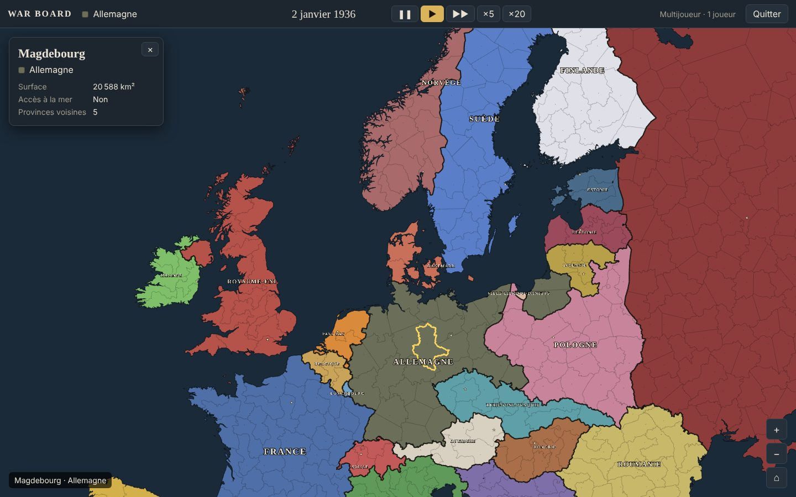

# War Board

Jeu de stratégie web sur la Seconde Guerre mondiale, en temps réel ralenti : une carte persistante de provinces, une gestion simplifiée (fronts, production, diplomatie) et un volet éducatif. Projet personnel, original : il s'inspire de mécaniques connues du genre sans en reprendre les noms, l'art ni les données.



Ce dépôt contient le **premier prototype** : la carte des provinces de l'Europe au 1er janvier 1936 et une simulation qui avance d'un jour toutes les 5 secondes, en solo ou à plusieurs.

## Démarrer

Prérequis : Node 22 ou plus récent et pnpm 10 (`corepack enable` suffit).

```bash
pnpm install
pnpm dev          # serveur de jeu (ws://localhost:2567) + client (http://localhost:5173)
```

Ouvrez http://localhost:5173, choisissez une nation, puis « Jouer en solo » ou « Rejoindre la partie multijoueur ». Pour jouer à plusieurs sur le même réseau, les autres joueurs ouvrent `http://<votre-ip>:5173`.

Autres commandes :

| Commande | Rôle |
| --- | --- |
| `pnpm test` | Tests de la simulation et du serveur |
| `pnpm typecheck` | Vérification TypeScript de tous les paquets |
| `pnpm build` | Build de production du client (`packages/client/dist`) |
| `pnpm map:build` | Régénère la carte depuis Natural Earth |
| `pnpm images:build` | Met à jour la bibliothèque d'illustrations depuis Wikidata et Wikimedia Commons |

## Organisation

```
packages/
  sim/      Simulation pure et déterministe, partagée par le serveur et le client
  server/   Serveur Colyseus : une salle « partie », 8 joueurs au plus
  client/   Vite + React + PixiJS : salon, carte, panneau de province
  tools/    Préparation de la carte à partir de Natural Earth
```

### Simulation (`packages/sim`)

- L'état d'une partie (`GameState`) ne contient que des nombres et des tableaux : il se sérialise en JSON et donne exactement le même résultat sur toutes les machines.
- `step(state, commandes)` avance d'un jour sans modifier l'état précédent. Aucun appel à `Date` ni à `Math.random` : le hasard passe par un générateur à graine stocké dans l'état.
- `GameClock` convertit le temps réel en jours : 1 jour pour 5 secondes à vitesse normale. Les vitesses ×2, ×5 et ×20 servent aux tests.
- Les ordres des joueurs sont appliqués au début du jour suivant, dans l'ordre reçu.
- L'économie est un simple compteur de production pour l'instant. La seule commande est un outil de test (« Annexer ») qui montre que les frontières se redessinent.

### Serveur (`packages/server`)

Colyseus 0.18. Le serveur fait tourner la simulation et synchronise vers les clients le jour, la vitesse, le propriétaire de chaque province et la liste des joueurs. Une nation ne peut être jouée que par une personne. Le premier joueur arrivé est l'hôte et règle la vitesse.

### Client (`packages/client`)

- En solo, la simulation tourne dans le navigateur avec la même fonction `step` que le serveur.
- La carte est dessinée avec PixiJS : couleur par propriétaire, frontières de nations recalculées à chaque changement, noms des pays, noms des provinces au zoom, capitales.
- Molette pour zoomer, glisser pour se déplacer, clic pour voir une province.

## La carte de 1936

`pnpm map:build` télécharge les régions administratives et les villes de [Natural Earth](https://www.naturalearthdata.com/) (domaine public) au 1:10 000 000, puis :

1. projette en conique conforme centrée sur l'Europe (4000 × 2810 unités) ;
2. simplifie en conservant les frontières communes ;
3. applique les frontières de janvier 1936 (`packages/tools/src/borders1936.ts`) : rattachement de régions entières (Silésie et Prusse-Orientale allemandes, Wilno et Lwów polonais, Bessarabie roumaine, Istrie italienne, colonies et mandats...) et découpes à la main là où la frontière coupe une région actuelle (couloir de Dantzig, ligne du traité de Riga, Carélie finlandaise, Dodécanèse...) ;
4. découpe les grandes régions autour de leurs villes principales et fusionne les trop petites, pour obtenir des provinces de taille comparable (environ 780) ;
5. nomme chaque province d'après sa plus grande ville, avec le nom d'époque quand il a changé (Königsberg, Breslau, Wilno, Lwów, Stalingrad...).

Le résultat est versionné : `packages/client/public/map/europe-1936.topo.json` (géométrie) et `packages/sim/src/scenario/provinces1936.json` (noms, propriétaires, voisinages, capitales). Le script est déterministe : deux exécutions donnent les mêmes fichiers.

Limites connues : les découpes tracées à la main sont approximatives (à quelques kilomètres près), les micro-États sont rattachés à leur voisin, et les provinces découpées sans ville notable portent un nom de région suivi d'une direction (« Vologda nord »).

## Les illustrations

Drapeaux de 1936, dirigeants, généraux, amiraux, navires, armes, villes et événements viennent de [Wikimedia Commons](https://commons.wikimedia.org/), retrouvés par leur article Wikipédia en français.

- Le catalogue est dans `packages/tools/src/images/catalog.ts` : une ligne par sujet. Pour en ajouter, il suffit d'ajouter une ligne et de lancer `pnpm images:build` (quelques minutes, l'outil va lentement pour respecter Wikimedia).
- L'outil prend l'image de l'élément Wikidata (P18), ou pour un drapeau celui en usage en 1936 (P41), et garde seulement le domaine public, CC0, CC BY et CC BY-SA.
- Il écrit `packages/client/public/images/manifest.json` (adresse de la vignette, auteur, licence, liens) et `packages/tools/images-report.md`, qui liste les sujets à corriger avec un `qid` ou un `file`.
- Par défaut, le jeu affiche les vignettes servies par Wikimedia. `pnpm images:build --download` les copie dans le client, pour un serveur qui ne dépend pas de Wikimedia.
- Côté client : `useImage("general:gamelin")`, le composant `<WikiImage id="…">`, et l'écran « Crédits des images » depuis le salon. Les images marquées sensibles (symboles nazis) sont légèrement floutées.

## Suite prévue

- Persistance des parties avec PostgreSQL.
- Unités, fronts, production et focus nationaux.
- Marine (zones maritimes, ports), puis diplomatie.
- Déploiement sur un petit VPS (serveur de jeu, base et proxy HTTPS en Docker Compose).

## Licences des données

Carte dérivée de Natural Earth, dans le domaine public. Les frontières de 1936 sont une reconstitution propre à War Board.

Illustrations : Wikimedia Commons, chacune sous sa propre licence (domaine public, CC0, CC BY ou CC BY-SA). L'auteur et la licence de chaque image sont dans `manifest.json` et affichés dans l'écran de crédits ; les licences CC BY et CC BY-SA demandent de les citer.
